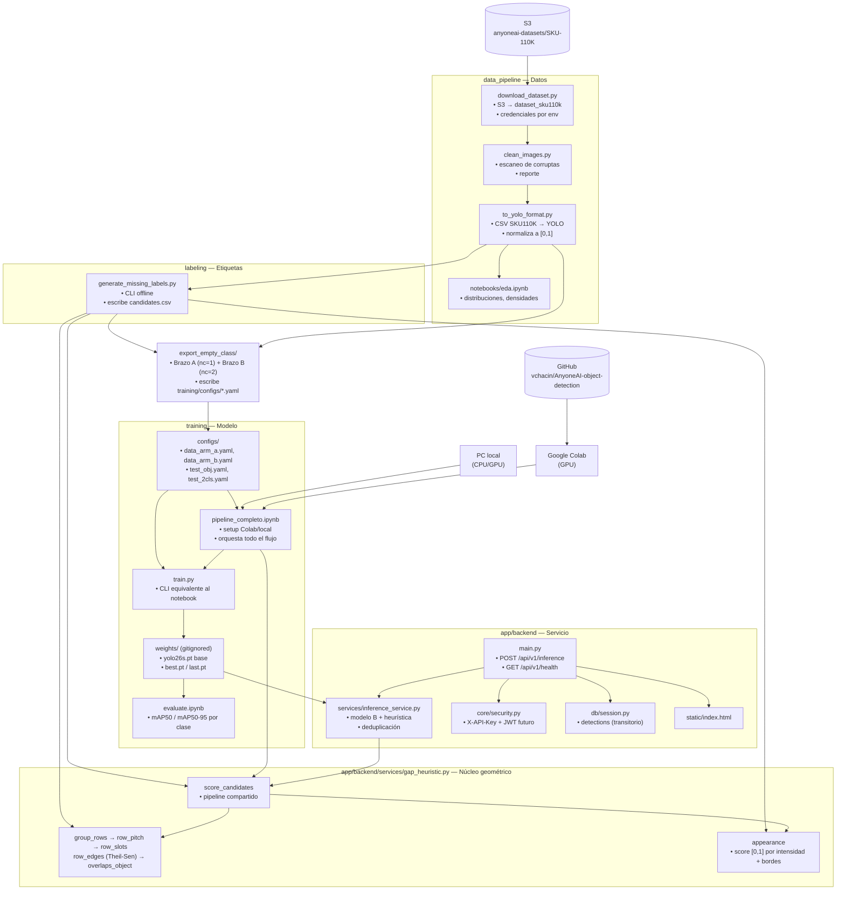
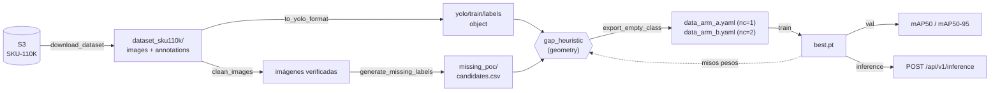
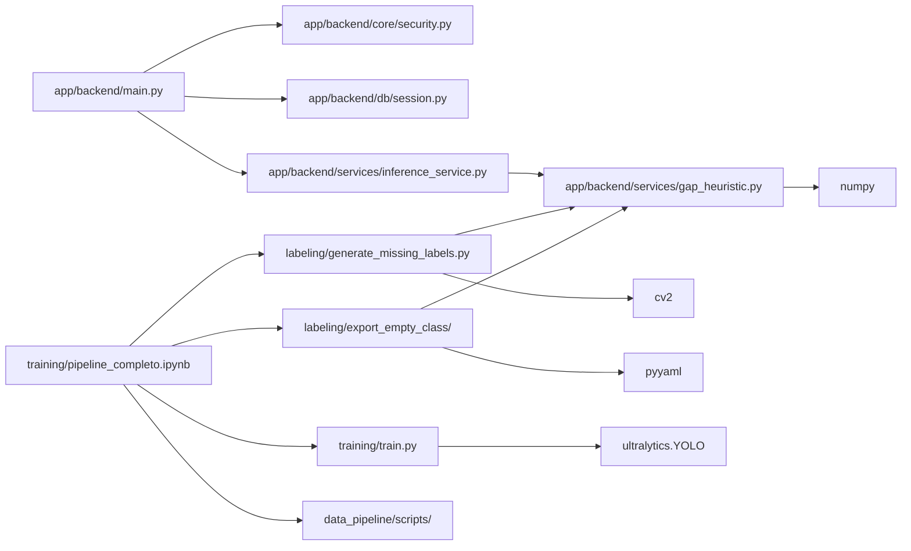

# Arquitectura — AnyoneAI Object Detection

Monolito modular: un repositorio, un despliegue, módulos con frontera explícita.
Este documento es la referencia de qué depende de qué.

## Vista de módulos

## Frontera de módulos

| Módulo | Responsabilidad | No hace |
|--------|-----------------|---------|
| `data_pipeline` | Conseguir y limpiar datos crudos | No entrena, no sirve |
| `labeling` | Derivar etiquetas (`missing`) y `data.yaml` | No entrena |
| `app/backend/services/gap_heuristic.py` | Geometría pura de huecos | No conoce FastAPI ni Ultralytics |
| `training` | Entrenar y evaluar | No lee S3 directamente (utiliza el notebook) |
| `app/backend` | Servir predicciones e infraestructura | No accede al dataset |

La regla que hace que esto funcione: **`app/backend/services/gap_heuristic.py` no importa nada
de `app/backend/`, `ultralytics` ni `fastapi`**. Es geometría pura sobre listas de
cajas. Esto permite que el etiquetado offline y el servicio en producción usen
literalmente el mismo código, y que la heurística se pruebe con `pytest` sin
GPU.

## Flujo de datos

## Strategy params

Todos los parámetros de la heurística se definen al inicio de
`app/backend/services/gap_heuristic.py` y se calibraron sobre 50 imágenes con ground truth humano:

| Knob | Valor | Significado |
|------|-------|-------------|
| `ROW_TOL` | 0.5 | Tolerancia de `y2` para agrupar en la misma repisa |
| `GAP_MIN_FRAC` | 0.6 | Hueco mínimo como fracción del pitch |
| `MAX_SLOTS` | 4 | Máximo de productos faltantes consecutivos por hueco |
| `EDGE_MIN_ROW` | 6 | Densidad mínima de una fila para emitir huecos de borde |
| `DARK` / `BRIGHT` | 30 / 90 | Rango de intensidad gris que puntúa como "fondo" |
| `EDGE_LOW` / `EDGE_HIGH` | 2 / 10 | Rango de magnitud de gradiente |
| `AUTO_SCORE` | 0.5 | Umbral para aceptar un hueco |

Se modifican en un único lugar y afectan por igual al etiquetado y a la API.

## Dependencias internas

## Arquitectura objetivo

El checkpoint oficial incorporado desde `master` vive en `modelos/best.pt` y se
monta como solo lectura en Docker. El serving utiliza la clase aprendida
`missing` cuando está disponible, conserva la heurística como complemento y
deduplica candidatos coincidentes por IoU. `app/frontend/` queda reservado para
la interfaz futura; routers, schemas y servicios aún no implementados son stubs
documentales definidos por el SDD.

## Decisiones

**Notebook todo terreno en lugar de scripts sueltos.** Colab y local ejecutan el
mismo flujo porque la celda 1 resuelve el entorno, dependencias y `ROOT_DIR`.
Los archivos `.py` existen igual (el notebook los invoca por subprocess) para
que el pipeline sea testeable y utilizable desde CI.

**La heurística no se reimplementa en la API.** `app/backend/services/gap_heuristic.py` es
geometría pura; tanto el etiquetador como el servicio la importan. Si divergieran,
un candidato aceptado por el notebook desaparecería en producción.

**`data.yaml` con ruta absoluta.** Ultralytics resuelve `path` relativo contra la
carpeta del propio yaml, no contra la raíz del repositorio, por lo que relativo
sería silenciosamente incorrecto. `export_empty_class.py` y el notebook
regeneran el yaml con la ruta real en cada entorno.

**`missing` se etiqueta por geometría, no manualmente.** El pitch de una repisa
es estable; los huecos de ≈1 producto se deducen. Esto permite escalar el brazo B
a las 8 000+ imágenes de entrenamiento.

## Seleccion de pipelines

El servicio mantiene un catalogo en `app/backend/services/model_registry.py`.
`official` conserva el flujo existente: un detector YOLO con la heuristica
compartida. `shelfvision` es un adaptador aislado que combina los pesos de
productos y faltantes del proyecto ShelfVision con agrupacion geometrica y
OpenCV. Ambos devuelven el contrato de `PredictResponse`; el pipeline
seleccionado se indica con `model` en `/api/v1/inference` y se anuncia en
`/api/v1/models`.

La carga es perezosa y cacheada por nombre. `DEFAULT_MODEL=official` mantiene
compatibilidad con despliegues existentes. Cada inferencia escribe un reporte
JSON versionado en `training/reports/inference/`, incluyendo identidad y hash
de pesos, configuracion, conteos y latencia. La bitacora no sustituye una
evaluacion: la comparacion debe usar las mismas imagenes y etiquetas para ambos
pipelines.
